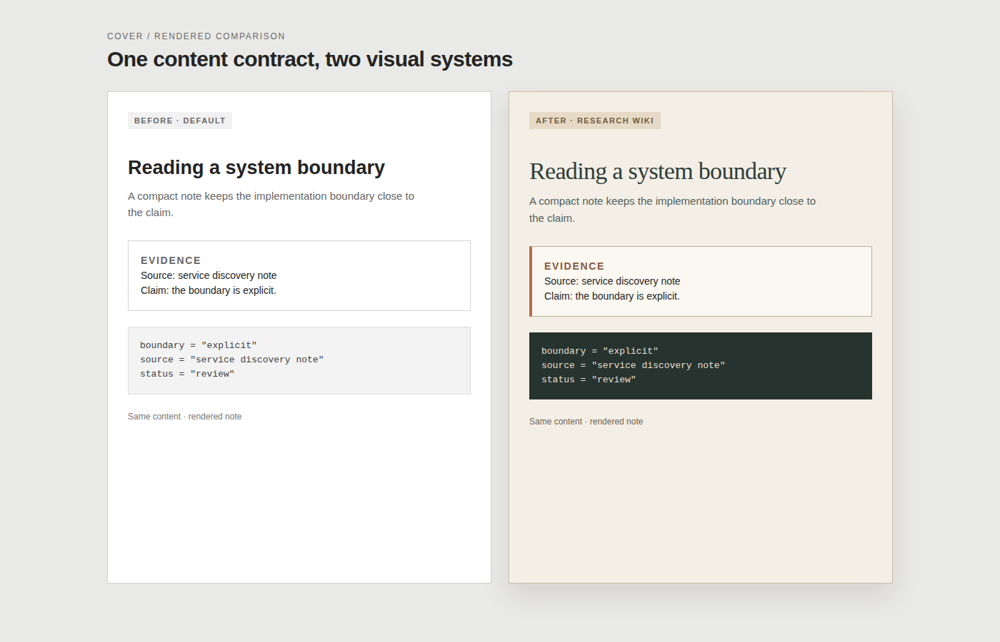

# Cover: turn visual intent into a usable design system

`cover` creates a project-owned `DESIGN.md`: a compact art direction and token specification that
page, image, and video workflows can consume consistently. It is for the moment
before implementation, when a project has a product, an audience, and a visual
direction, but not yet a coherent token system.

`SKILL.md` remains the execution contract. This README is a human-facing tour
of the result, its inputs, and the boundary around it.

## What it produces

```text
product intent + audience + constraints
                 ↓
reference vocabulary (2–4 inspected specifications or works)
                 ↓
project-specific visual thesis
                 ↓
DESIGN.md + .design/evidence.json
                 ↓
Page/image/video workflows consume direction and medium rules
```

The output defines a recognizable artistic direction and derives palette roles,
typography, spacing, components and medium rules from it. Warm paper is one
project choice, not the default for all work. A video-facing contract includes
motion, editing and sound intentions; producing a film remains the video
workflow's responsibility.

## A typical request

> 为一个面向工程师的研究 Wiki 做设计规范：阅读密度高，但章节开场希望有温暖、观察式的编辑感；数据表、代码和证据必须保持清晰。

`cover` first distinguishes the durable constraints from the style request:

| Input | Design consequence |
|---|---|
| Technical research reader | Analytical body text, legible tables and code |
| Warm editorial opening | A restrained display voice and a limited pigment family |
| Evidence must remain clear | Decoration never carries claims; status colors keep their semantics |
| Existing project assets | Existing brand constraints override reference preferences |

It then studies two to four relevant specifications or directly inspected works, adapts their
vocabulary to this project, and records the sources in `.design/evidence.json`.
The evidence file makes the synthesis inspectable and explicitly flags
wholesale copying as invalid.

## Illustrative output shape

This is a shortened shape, not a reusable default palette:

```yaml
---
version: alpha
name: Research Wiki
description: Dense analytical reading with a warm, restrained editorial entry.
---

colors:
  primary: "#..."
  ink: "#..."
  canvas: "#..."
  surface-card: "#..."
  success: "#..."
  warning: "#..."
  error: "#..."

typography:
  display-lg: { fontFamily: "...", fontSize: 48px }
  body-md: { fontFamily: "...", fontSize: 16px }
  code: { fontFamily: "...", fontSize: 14px }

spacing:
  unit: 4px
  section: 72px

components:
  evidence-card:
    rule: "Keep the source and measurement close to the claim."
```

A useful `DESIGN.md` contains enough direction to make later artifacts agree,
but not prescriptive HTML, CSS, or JSX. It has one visual thesis rather than a
bag of disconnected fashionable tokens.

## How it connects to the visual workflow

`cover` establishes the reusable project contract. The producing agent resolves
the artifact direction and selects a layout for the reader task, adapting it to
that direction. Website specifications supply useful implementation references;
the art catalog supplies expressive vocabulary. Neither is a compulsory menu.
See [reference collaboration and ownership](references/cross-media-design.md)
for priorities, scoped overrides and one-off work without a new DESIGN.md. For an
evidence-heavy page, the same system can allow an editorial header while
keeping charts, tables, code, screenshots, and status signals analytical.

```text
cover                  renderer / implementation              review
DESIGN.md       →      layout + content + project tokens  →    technical and visual gates
visual thesis          provenance and responsive artifact       adoption decision
```

This separation is deliberate: a page can be technically correct yet visually
unconvincing, and visually attractive yet unsuitable for evidence. Both need
their own review.

## Verification and boundaries

Every generated design specification is accompanied by
`.design/evidence.json`. Run:

```bash
python3 skills/cover/scripts/synthesis_gate.py \
  --design /absolute/path/to/DESIGN.md \
  --evidence /absolute/path/to/.design/evidence.json
```

The gate requires a nontrivial `DESIGN.md`, at least two distinct source strings,
and explicit `wholesale_copy: false`; more than four references produce a warning.
It reports structural validity only. Artistic fidelity needs actual sample
inspection, and user acceptance remains separate.

Use `cover` when visual direction needs to become a reusable project contract.
Do not use it for a one-off color tweak, for copying a branded interface, or
as a substitute for accessibility, responsive testing, or a visual review of
the rendered result.

## Cross-media identity

Cover selects and adapts references → project DESIGN.md records identity →
Breach renders HTML; image and video capabilities produce their own formats.
An HTML storyboard or preview is not an exported film.

The [cross-media contract](references/cross-media-design.md) specifies ownership,
optional DESIGN fields, evidence, and video handoff. The
[reference pool](references/visual-references.md) includes art and launch films
with explicit inspection limits. Neither requires a new video skill to exist.

## Related artifacts

- [`SKILL.md`](SKILL.md): agent-facing trigger, synthesis and gate contract.
- [`implementation-anti-slop.md`](references/implementation-anti-slop.md):
  functional implementation checks; read only when building or reviewing UI from a
  generated specification.
- [`synthesis_gate.py`](scripts/synthesis_gate.py): deterministic output gate.

## Rendered comparison

The same research-Wiki content is shown before and after the design system is
applied. The comparison is a local, reproducible HTML render:



Inspect the [HTML source](examples/before-after.html) to reproduce the PNG.


## Extensible style selection

The [style-routing contract](references/style-routing.md) separates new source
registration, evidence-based visual observation, candidate matching, project
selection and renderer handoff. The JSON catalog supplies stable IDs and
medium treatments; adding a reference or style does not require per-style code.
The CLI reports selected/proposed/ambiguous/insufficient states with evidence,
not a fictional visual-recognition confidence score. It validates agent-observed
features; it does not watch films. Existing project specifications remain valid.


A catalog selection resolves a family, not a finished work. Each new image,
HTML artifact and video needs a subject-led visual idea and signature choices;
shared tokens do not authorize copying the last composition. Functional checks
verify readability and operation without prescribing an aesthetic. Final
artistic review remains tied to the rendered work, not the routing status.
